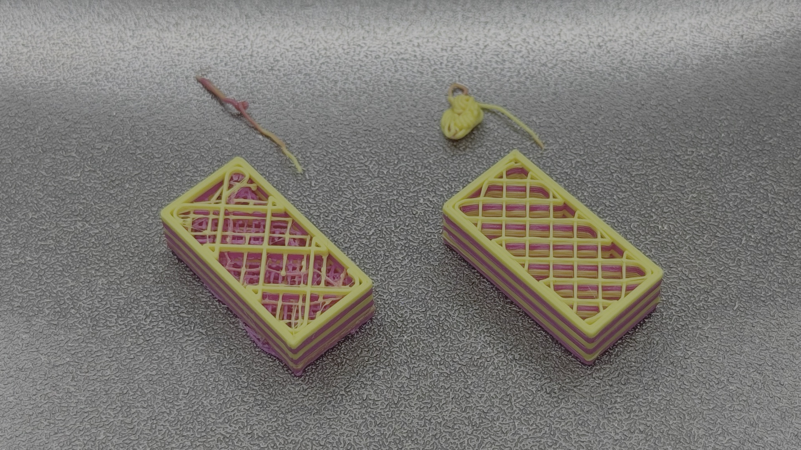
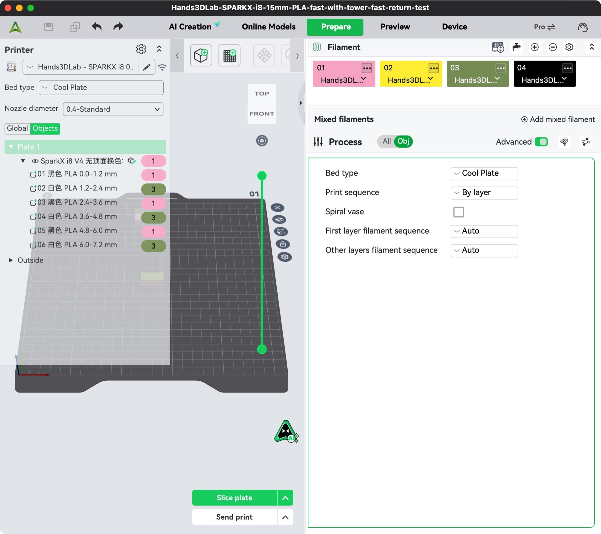
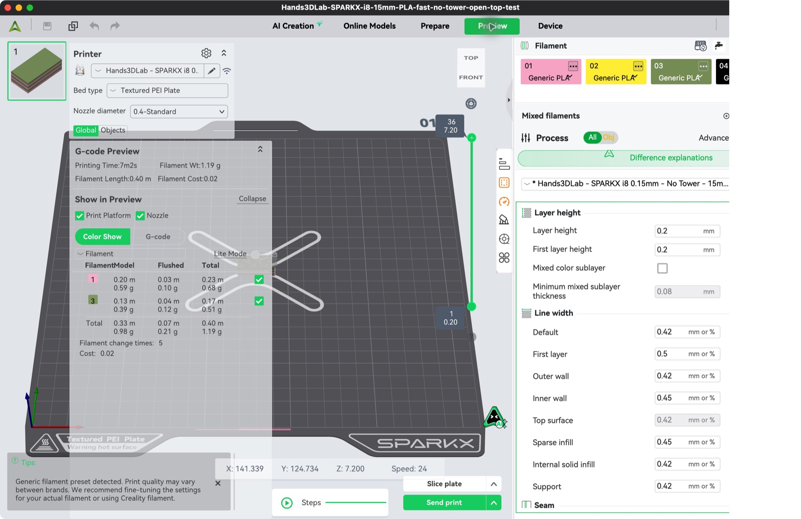
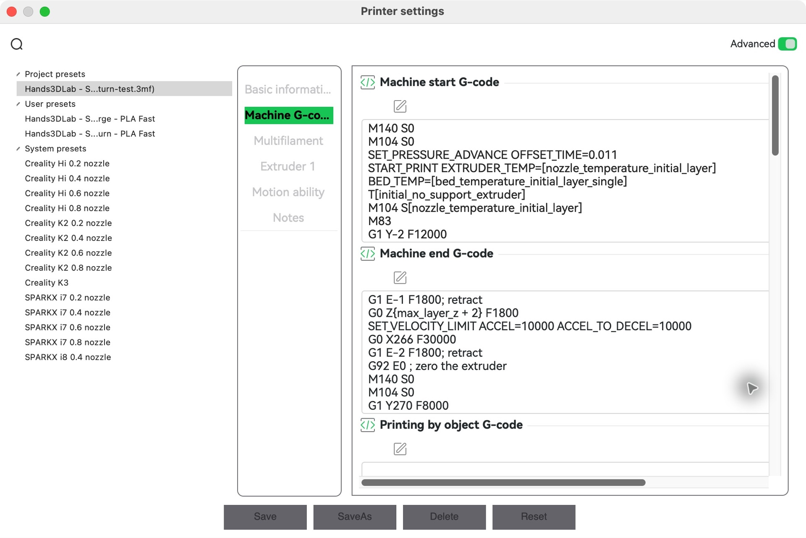
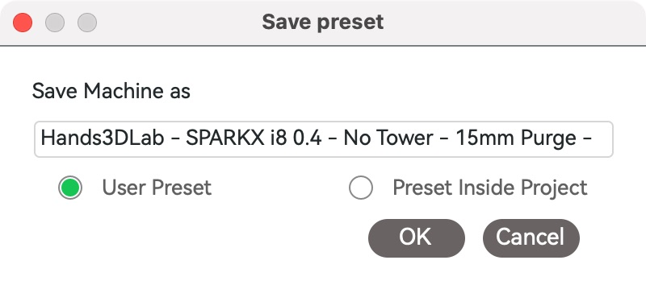

# SPARKX i8 Side Purge · Hands3DLab

The SPARKX i8's four-channel hotend is designed for fast filament changes. If the purge is too short for a given change, the previous color can bleed into the next one and extrusion can restart unevenly or leave gaps. These presets purge at the side before printing resumes on the model, giving the color and flow time to settle. [Creality's color change guide](https://wiki.creality.com/en/sparkx/i8/no-prime-tower-mode)

Experimental Creality Print presets for the **SPARKX i8 with a 0.4 mm nozzle and PLA**. Each eligible color change on the supplied test plates purges **15 mm of filament** at the side wiper. Choose [With tower](presets/with-tower/) or [No tower](presets/no-tower/).

[简体中文](README.zh-CN.md) · [Illustrated guide](docs/guide.en.md) · [Design rationale](docs/guide.en.md#4-why-it-works-this-way) · [Before printing](docs/safety.en.md) · [Hands3DLab Software](https://hands3dlab.com/soft)

> **Open-source release, provided as is.** No warranty, official support, or compensation is offered. Use is at your own risk. To the extent permitted by applicable law, the authors and contributors are not liable for equipment damage, injury, failed prints, wasted material, or other loss. Read the [safety and liability notice](docs/safety.en.md) before printing.

Both test plates were checked in [Creality Print 7.3.2](https://github.com/CrealityOfficial/CrealityPrint/releases/tag/v7.3.2). Hardware behavior depends on the printer, firmware, and filament.

## 1. Open a test project or import presets

For the quickest check, open the `.3mf` from the [with-tower](presets/with-tower/) or [no-tower](presets/no-tower/) folder as a **project**. The included coupon has six color bands and an open top so you can inspect the infill. Check the loaded presets before slicing.

For your own model, open it first, then choose **File → Import → Import Configs**. Select both the `*-machine.json` and `*-process.json` from the same folder. With tower also uses `*-filament.json`. Importing adds presets to the lists. Select them on the **Prepare** page, especially after opening a project with older embedded settings.

| Control | What to select |
| --- | --- |
| **Printer** | A Hands3DLab SPARKX i8 printer ending in `PLA Fast`. Match `With Tower` or `No Tower` and confirm 0.4 mm nozzle. |
| **Filament** | Verify the color-to-slot mapping. With tower, select `Hands3DLab - SPARKX i8 Generic PLA - Side Purge` for each slot that participates in the test. This enables the reduced tower purge settings. No tower can use the included project's Generic PLA settings. |
| **Process** | Select the matching `With Tower` or `No Tower` process ending in `PLA Fast`. Verify **Prime tower** is on or off as intended. |
| **Slice plate** | Slice once the printer, process, and filament selections are correct. |

## 2. Verify the sliced result

1. Open **Preview** and scrub through the color changes. The with-tower plate should show a prime tower. The no-tower plate should show the coupon without a tower. Custom wiper moves may sit outside the normal build area or may not be visible in Preview.

   

   
2. Use **Export G-code** and open the exported `.gcode` in a text editor. Search for `I8_SIDE_PURGE_BEGIN` on its own line, so the copy of the template in the file's settings is excluded. The supplied test projects should produce **five** blocks. Each block has a `T` command followed by `G1 E10` and `G1 E5` under relative extrusion (`M83`). Feed rates may differ with the filament profile. For the with-tower project, look for `I8_TOWER_RETURN` followed by an XY move with `F24000`.

   
3. If a block is missing, first recheck the selected printer and process. The no-tower route depends on how Creality Print schedules each change. A different model or firmware may behave differently, so check the actual output before sending it to the printer.

## 3. Adjust the side purge or restore the defaults

1. In **Prepare**, click the pencil beside the printer preset to edit it. Open **Machine gcode → Change filament G-code**. You can paste the matching `*-change-filament.txt` here. Its commented `STOCK` section is a reference copy.

   
2. To adjust the total, find `EDIT SIDE_PURGE_MM` in the active block. In `G1 E{15 - 10}`, change `15` to the total filament length in millimeters. Keep it above `10` because the first step already feeds 10 mm. The with-tower filament uses a separate **12 mm³** minimum purge on the tower. The tower value is a volume.

   

3. **Save as** a new user preset, reslice, and repeat the checks. To restore factory behavior, select the original printer, process, and filament presets and slice again.

   

## MIT License

Original contributions are licensed under the [MIT License](https://opensource.org/license/mit). Copyright © 2026 Hands3DLab. Bundled upstream G-code retains its original license. [Creality Print v7.3.2 upstream source](https://github.com/CrealityOfficial/CrealityPrint/tree/v7.3.2)
