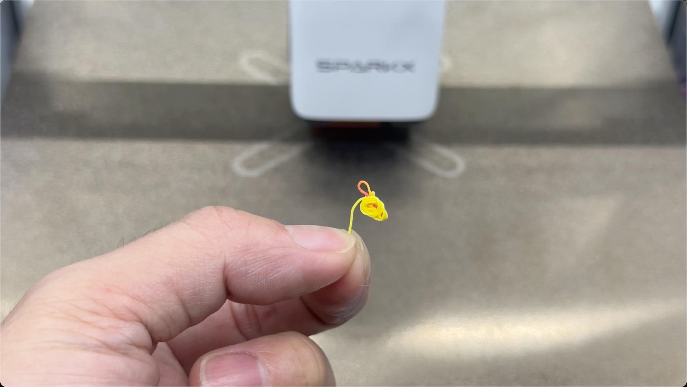

# SPARKX i8 Side Purge

[简体中文](README.zh-CN.md) · [Hands3DLab Software](https://hands3dlab.com/soft)

## 1. Why purge at the side

After a filament change, some of the previous color can remain in the hotend. Resuming too early can leave color bleed or uneven extrusion. This template feeds **15 mm of filament (10 + 5 mm)** at the side wiper before the nozzle returns to the model or prime tower.

**Figure 1. Two-color test prints.** The left coupon shows more pink in the top grid and more irregular lines. The yellow grid on the right is more continuous. The pieces above the coupons are purge waste.

**Figure 2. Side purge waste.** The wiper removes the filament extruded at the start of the color transition. The template’s **15 mm** refers to filament feed length. The selected process and filament presets still control the purge volume at the prime tower.

## 2. Install and verify

For the **SPARKX i8 with a 0.4 mm nozzle and PLA**. The supplied test projects were sliced in Creality Print 7.3.2. [Creality Print 7.3.2](https://github.com/CrealityOfficial/CrealityPrint/releases/tag/v7.3.2)

**Strongly recommended: paste the template directly into the Change filament G-code field.** Save a copy of the current official printer preset and change this one field to preserve the current motion, temperature, and other machine defaults. After a slicer upgrade, start with a fresh copy of the updated official preset and verify the template with a new slice.

1. In **Prepare**, select the official **SPARKX i8 0.4 mm** preset. Click the pencil next to it and open **Machine G-code → Change filament G-code**. Back up the existing field.
2. Choose the template that matches **Prime tower**: [With-tower G-code](gcode/sparkx-i8-with-tower-change-filament.txt) · [No-tower G-code](gcode/sparkx-i8-no-tower-change-filament.txt). Copy the whole file into the field, then use **Save as** to create a user printer preset.
3. Slice with the new preset. Check the color changes and prime tower in **Preview**. Use **Export G-code** and check the actual tool changes for a standalone `; I8_SIDE_PURGE_BEGIN` line followed by `G1 E10` and `G1 E5`. The supplied coupons should show five side purge blocks. Without a tower, side purging depends on the slicer invoking the filament-change template.

[With-tower test project and presets](presets/with-tower/) · [No-tower test project and presets](presets/no-tower/) · [Illustrated steps and purge adjustments](docs/guide.en.md)

## 3. Risks and precautions

- **Check the wiper path and filament-slot mapping before printing.** The custom moves reach `X266` and `X277`. Preview may omit some of these moves. Reslice and inspect the exported code after a firmware or slicer upgrade.
- **Supervise the first small test.** Clear the side wiper and waste area. Stop if you notice a collision, unusual noise, or a failed filament change. To restore default behavior, select the original presets and slice again.
- The project is provided as is. Read the [full safety and liability notice](docs/safety.en.md) before printing.

## MIT License

Copyright © 2026 Hands3DLab. Original contributions are available under the [MIT License](https://opensource.org/license/mit). Bundled upstream G-code retains its original license. [Creality Print upstream source](https://github.com/CrealityOfficial/CrealityPrint/tree/v7.3.2)
