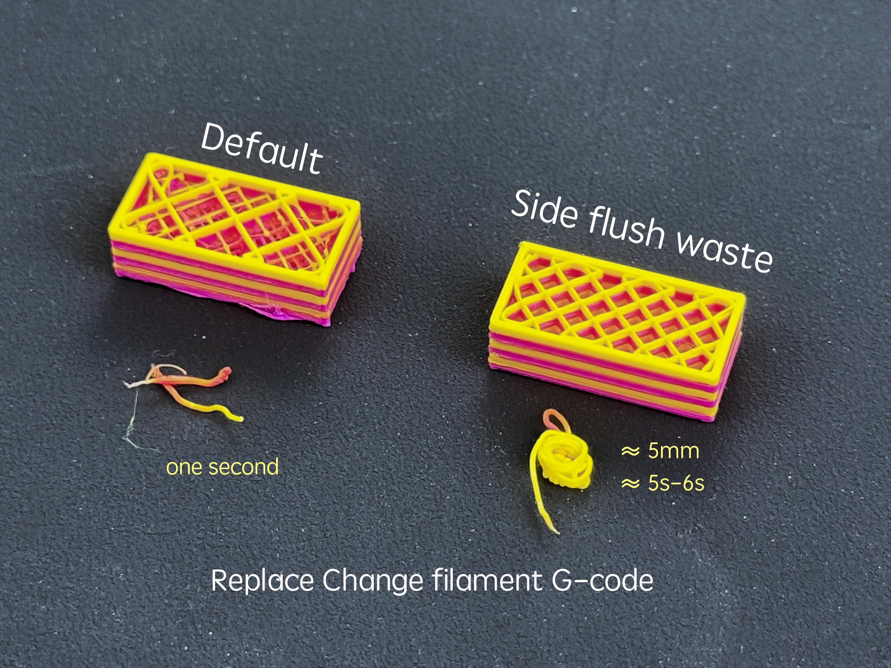
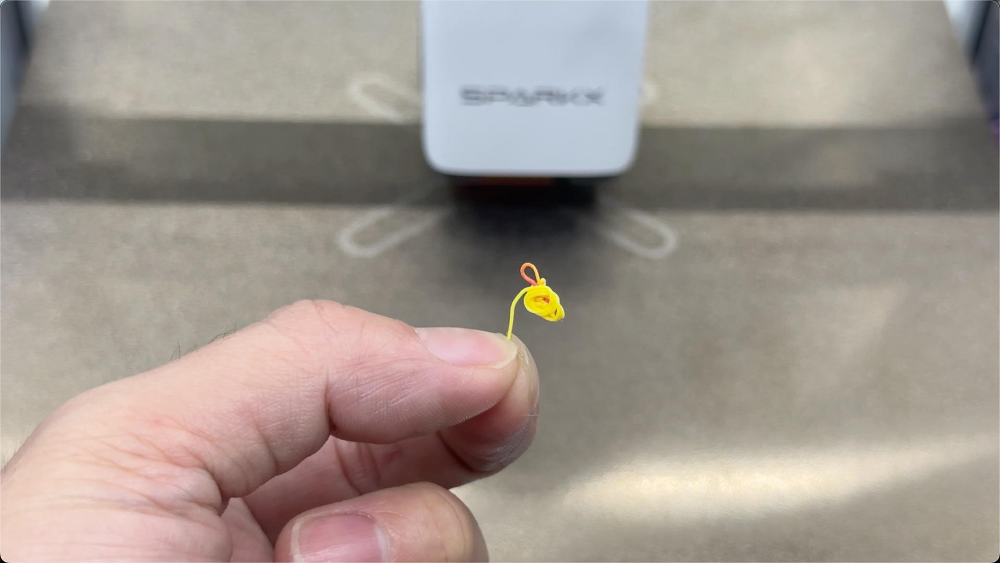
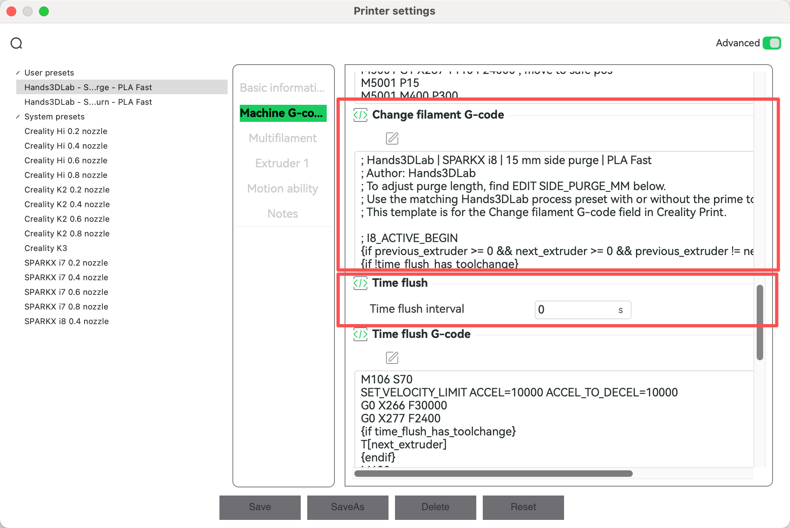
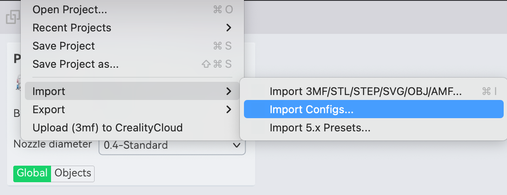

# SPARKX i8 侧边冲刷

[English](README.md) · [Hands3DLab 软件](https://hands3dlab.com/soft)

**[v0.1 for Creality Print 7.3.2](https://github.com/Hands3DLab/sparkx-i8-side-purge/releases/download/v0.1-for-CrealityPrint-7.3.2/Hands3DLab-Sparki8-0.4-v0.1-for-CrealityPrint-7.3.2.zip)** · 点击版本号下载 ZIP

下载包按 `with-tower`（带塔）和 `no-tower`（无塔）分组，按是否启用擦料塔选择。独立换料代码见 `gcode/Hands3DLab-Sparki8-0.4-with-tower.txt` 或 `gcode/Hands3DLab-Sparki8-0.4-no-tower.txt`。

## 1. 为什么会串色，侧边冲刷有什么效果

在 **Creality Print 7.3.2** 和 SPARKX i8 现有的四通道快速换料方案下，换料后热端仍可能残留上一种颜色。如果恢复打印前的冲刷量不足，尤其是深色换浅色时，残色可能混入新料并出现在模型上。这个模板在喷嘴回到模型或擦料塔之前，先到侧刷处送丝 **15 mm（10 + 5 mm）**，减少换色初段的串色。

> [!WARNING]
> **时间代价。** 每次触发侧边冲刷的换色粗估多花 **6 秒**，其中本次擦料改进比旧版约多 **1 秒**，实际时间随配置变化。换色次数多时，额外时间会累积。如果对打印时长敏感，请勿导入这套预设或启用侧刷模板。

**图 1　双色试片。** 左侧是默认换料，黄色顶层网格可见粉色残留和不规则线条。右侧是替换换料 G-code 后的试片，黄色网格更连续。下方是各自排出的废料。

**图 2　侧刷废料近照。** 换色初段挤出的耗材在侧刷处被刮下。模板里的 **15 mm** 指送入热端的耗材长度。擦料塔的冲刷体积由当前工艺和耗材预设控制。

## 2. 安装与验证

适用配置为 **SPARKX i8、0.4 mm 喷嘴、PLA**。随附试片已用 Creality Print 7.3.2 切片检查。[Creality Print 7.3.2](https://github.com/CrealityOfficial/CrealityPrint/releases/tag/v7.3.2)

### 方式 A：手动替换（推荐）

从当前官方机型预设另存副本，只替换「换料 G-code」字段，保留当前版本的运动、温控等机器设置。升级后可从新版官方预设重新建副本，再核对模板和切片结果。

1. 在 **Prepare** 选择官方 **SPARKX i8 0.4 mm**，点击机型旁的铅笔，进入 **Machine G-code → Change filament G-code**。先备份原字段内容。
2. 按 **Prime tower** 开关选模板：[带擦料塔 G-code](gcode/Hands3DLab-Sparki8-0.4-with-tower.txt) · [无擦料塔 G-code](gcode/Hands3DLab-Sparki8-0.4-no-tower.txt)。复制文件全文，替换字段，并用 **Save as** 保存为新的用户机型预设。

   

   **图 3　换料 G-code 设置。** 上方红框是粘贴位置。下方显示随附预设的 **Time flush interval 为 0 秒**。若定时冲刷接管换料，此模板会跳过侧刷。

**推荐设置。** 要复现随附试片的侧刷行为，在机型副本里将 **Time flush interval** 设为 **0 秒**，并让 **Prime tower** 开关与所选模板一致。带塔试片的随附耗材预设使用 **额外预冲刷 0 mm³**、**塔上最小冲刷 12 mm³**。手动替换时可先保留自己的耗材配置，再按切片结果决定是否调整塔上的冲刷量。

### 方式 B：一键导入

快速试用时，把[带塔](presets/with-tower/)或[无塔](presets/no-tower/)文件夹内的 `*-test.3mf` 作为项目打开，即可载入随附预设。用于自己的模型时，通过 **File → Import → Import Configs** 一次选中同组的 `*-printer.json`（机型）和 `*-process.json`（工艺），带塔组同时选中 `*-filament.json`（耗材）。回到 **Prepare** 选用导入的预设，核对擦料塔开关和料槽。

**图 4　导入预设入口。** 在 **File → Import** 菜单中选择 **Import Configs…**。

### 切片验证

两种安装方式都要重新切片。在 **Preview** 核对换色及擦料塔，再通过 **Export G-code** 检查实际换色段是否含有单独一行 `; I8_SIDE_PURGE_BEGIN`，以及之后的 `G1 E10` 和 `G1 E5`。随附试片应有五段侧刷代码。无塔模式取决于切片器是否调用换料模板。

[带塔试片和预设](presets/with-tower/) · [无塔试片和预设](presets/no-tower/) · [图文操作与冲刷量调整](docs/guide.zh-CN.md)

**v0.1** 已将擦料改进合并到两种正式模板及全部随附预设：冲刷后回抽卸压、PLA 风冷 1.8 秒、擦拭三次并减速离开。带塔版回塔后补回回抽量，无塔版由切片器恢复出料。维护者实测反馈挂料已有改善，效果仍受耗材和擦片状态影响。

## 3. 风险与注意事项

- **同一实际耗材请在切片前统一分配。** 模板按切片时的逻辑耗材编号判断换料。如果只在发送打印时将多个逻辑耗材映射到同一物理料槽，已生成的侧刷动作仍可能执行。请先在 **Prepare** 中将这些区域分配到同一个逻辑耗材，再重新切片。
- **上机前检查侧刷路径和料槽映射。** 自定义移动会到达 `X266` 和 `X277`，预览可能无法显示完整动作。更换固件或升级切片器后，重新切片并检查导出的代码。
- **首印用小试片，全程看护。** 清理侧刷及废料区，遇到碰撞、异响或换料失败时立即停机。恢复默认行为时，选回原预设并重新切片。
- 项目按现状提供。使用前请阅读[完整注意事项与免责说明](docs/safety.zh-CN.md)。

## MIT License

Copyright © 2026 Hands3DLab。原创内容采用 [MIT 许可证](https://opensource.org/license/mit)。随附的上游 G-code 沿用原许可。[Creality Print 上游源码](https://github.com/CrealityOfficial/CrealityPrint/tree/v7.3.2)
