# Illustrated setup guide

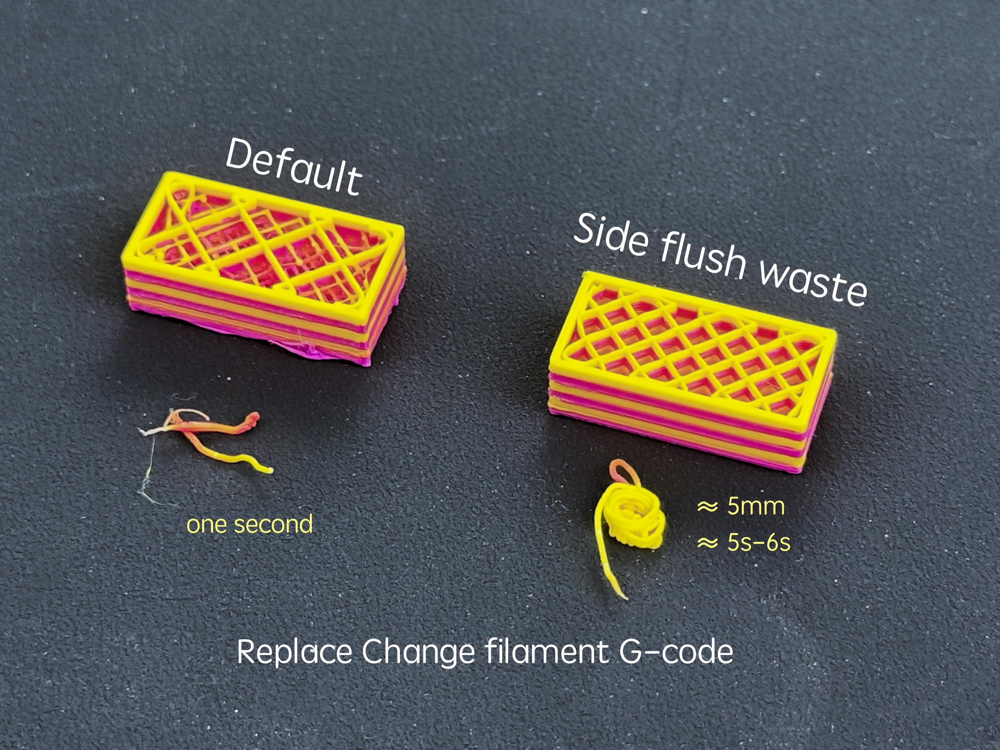

[简体中文](guide.zh-CN.md) · [Safety and liability](safety.en.md) · [README](../README.md)

> [!WARNING]
> **Time cost.** Side flushing adds roughly **6 seconds per color change** when it runs, including about **1 extra second** for the improved wipe compared with the previous template. These are estimates; actual time varies. The extra time adds up on prints with frequent changes. If print time is a priority, skip both the preset import and the side-flush template.

**v0.1 wipe update.** Both installation options include pressure relief, 1.8 seconds of PLA cooling, three wipes, and a final departure at 100 mm/s. With a tower, the preset retract length is restored at the tower. Without a tower, the slicer handles recovery. The supplied retract length is 0.8 mm; zero disables pressure relief. Check waste pickup and the first line after returning.

## 1. Install

For the **SPARKX i8 with a 0.4 mm nozzle and PLA**. The supplied test projects were sliced in Creality Print 7.3.2. [Creality Print 7.3.2](https://github.com/CrealityOfficial/CrealityPrint/releases/tag/v7.3.2)

### Option A · Manual replacement (recommended)

Save a copy of the current official printer preset and replace the **Change filament G-code** field. This preserves the current motion, temperature, and other machine defaults. After a slicer upgrade, start with a fresh copy of the updated official preset and verify the template with a new slice.

1. In **Prepare**, select the official **SPARKX i8 0.4 mm** preset. Click the pencil next to it and open **Machine G-code → Change filament G-code**. Back up the existing field.
2. Choose the template that matches **Prime tower**: [With-tower G-code](../gcode/Hands3DLab-Sparki8-0.4-with-tower.txt) · [No-tower G-code](../gcode/Hands3DLab-Sparki8-0.4-no-tower.txt). Copy the whole file into the field, then use **Save as** to create a user printer preset.

   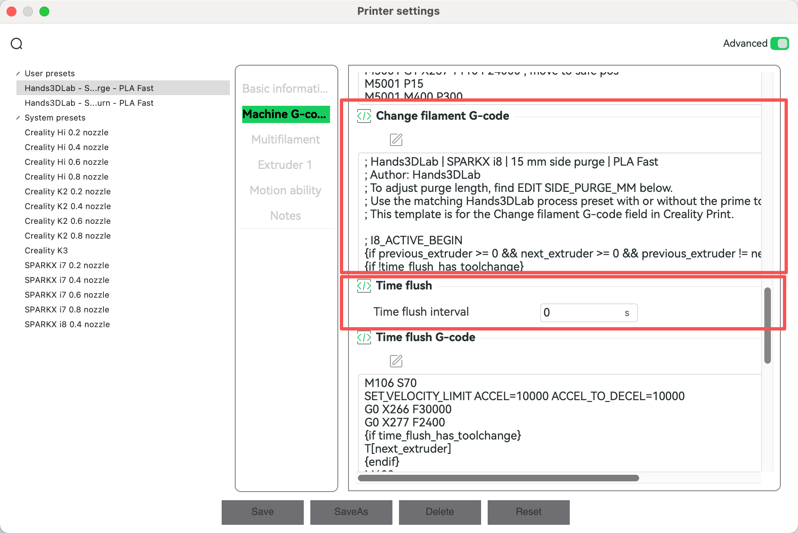

   **Filament-change G-code settings.** Paste into the upper highlighted field. The lower box shows the supplied preset’s **Time flush interval of 0 seconds**. The template skips the side flush when timed flushing handles the tool change.

**Recommended settings.** To reproduce the supplied test setup, set **Time flush interval** to **0 seconds** in the printer preset copy and match **Prime tower** to the template you chose. The bundled with-tower filament preset uses **0 mm³ extra pre-flush** and a **12 mm³ minimum tower flush**. With manual replacement, start with your existing filament preset and adjust tower flushing only after checking the slice.

### Option B · One-click import

For a quick test, open `*-test.3mf` in the [with-tower](../presets/with-tower/) or [no-tower](../presets/no-tower/) folder as a project to load the bundled settings. For your own model, use **File → Import → Import Configs** to select `*-printer.json` and `*-process.json` from the matching folder together. Include `*-filament.json` for the with-tower setup. In **Prepare**, select the imported presets and check the prime tower and filament slots.

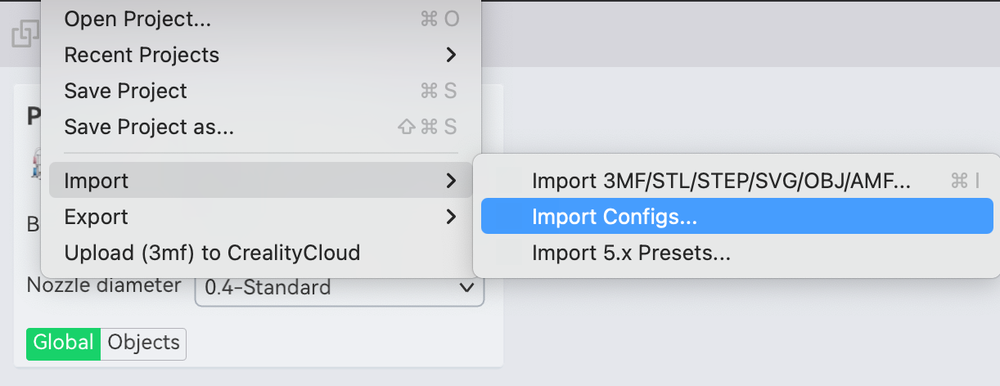

**Import presets.** Choose **Import Configs…** from **File → Import**.

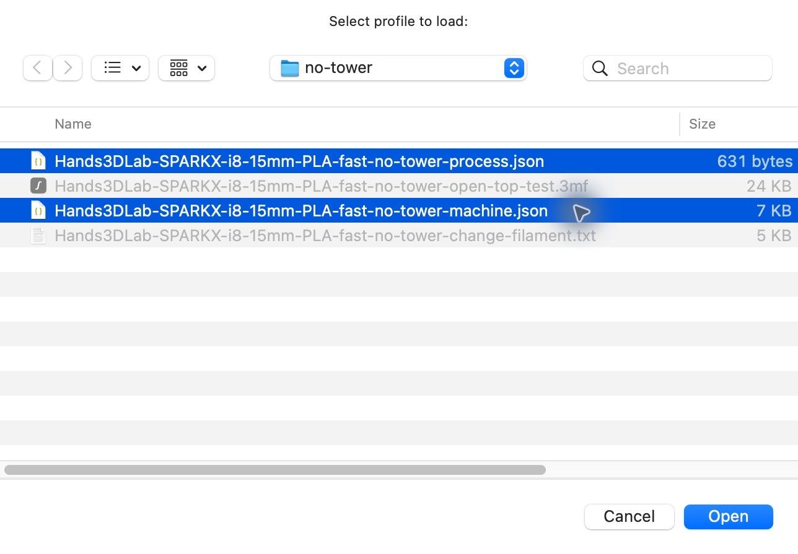

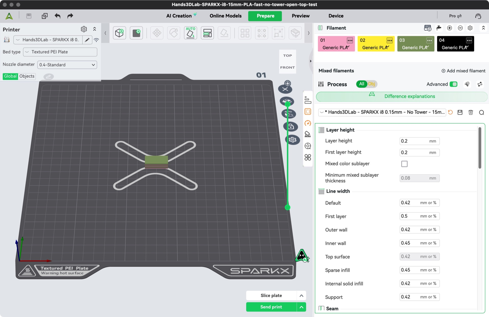

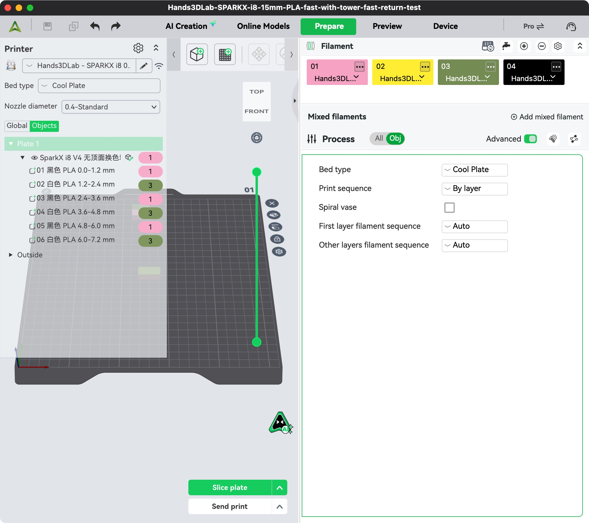

| Control | What to select |
| --- | --- |
| **Printer** | `Hands3DLab - Sparki8 - 0.4 - With Tower` or `Hands3DLab - Sparki8 - 0.4 - No Tower`. Match the tower setting and confirm a 0.4 mm nozzle. |
| **Filament** | Verify the color-to-slot mapping. With tower, select `Hands3DLab - Sparki8 - 0.4 - PLA` for each slot that participates in the test. This enables the reduced tower flush settings. No tower can use the included project's Generic PLA settings. |
| **Process** | Select the matching `With Tower` or `No Tower` preset ending in `Process`. Verify **Prime tower** is on or off as intended. |
| **Slice plate** | Slice once the printer, process, and filament selections are correct. |

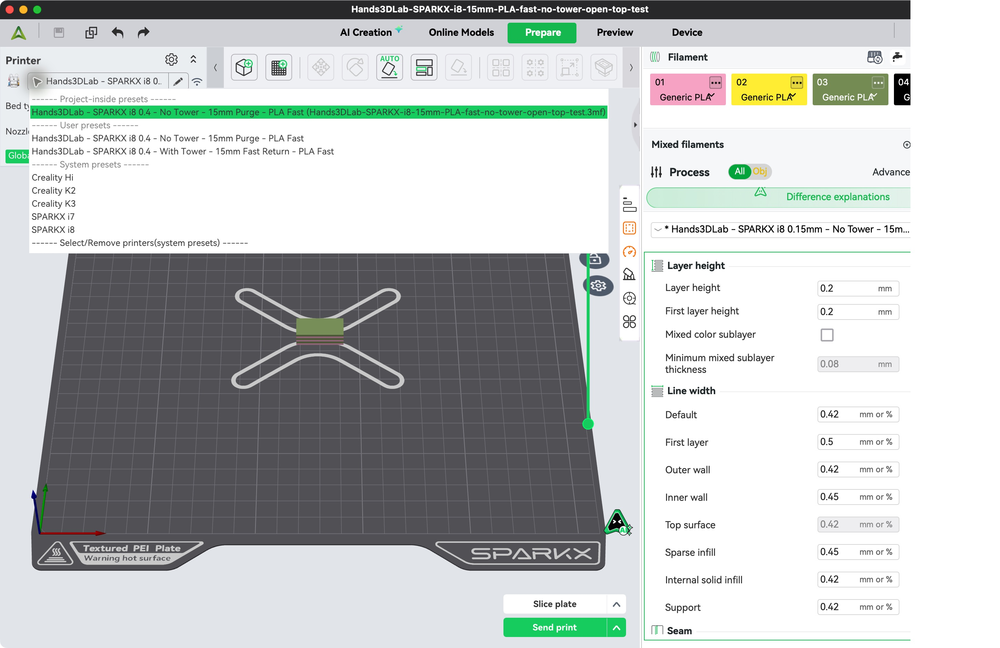

## 2. Verify the sliced result

1. Open **Preview** and scrub through the color changes. The with-tower plate should show a prime tower. The no-tower plate should show the coupon without a tower. Custom wiper moves may sit outside the normal build area or may not be visible in Preview.

   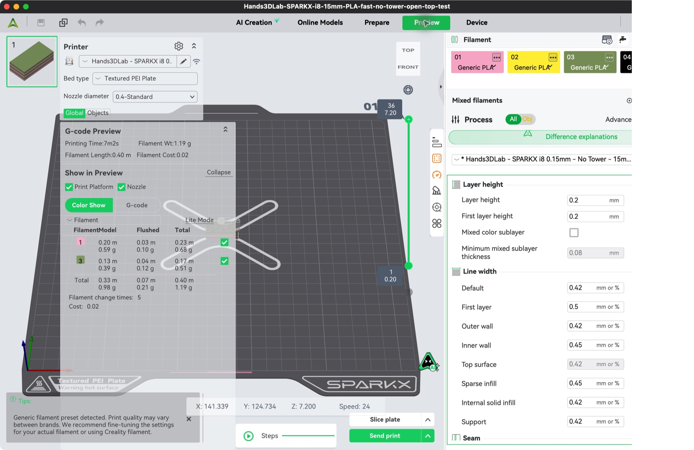

   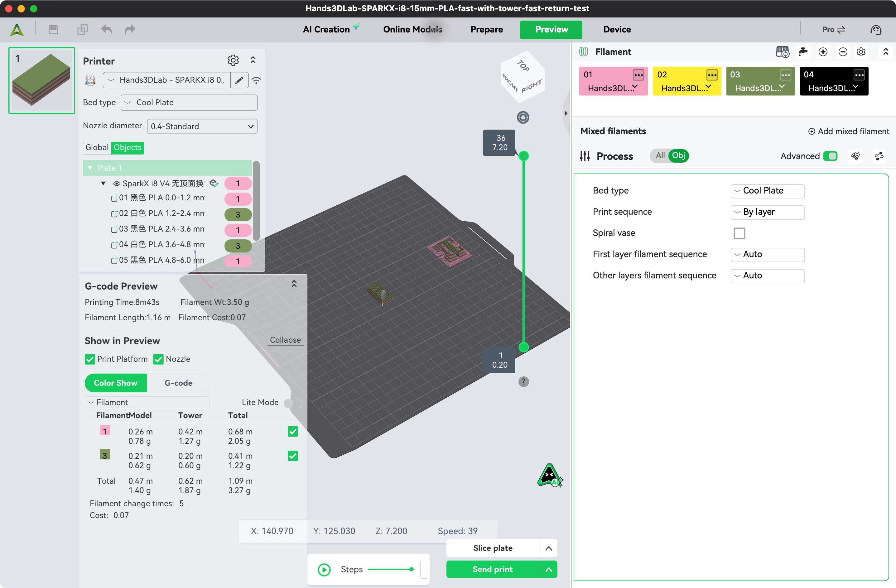
2. Use **Export G-code** and open the exported `.gcode` in a text editor. Search for `I8_SIDE_PURGE_BEGIN` on its own line, so the copy of the template in the file's settings is excluded. The supplied test projects should produce **five** blocks. Each block has a `T` command followed by `G1 E10` and `G1 E5` under relative extrusion (`M83`). Feed rates may differ with the filament profile. For the with-tower project, look for `I8_TOWER_RETURN` followed by an XY move with `F24000`.

   
3. If a block is missing, first recheck the selected printer and process. The no-tower route depends on how Creality Print schedules each change. A different model or firmware may behave differently, so check the actual output before sending it to the printer.

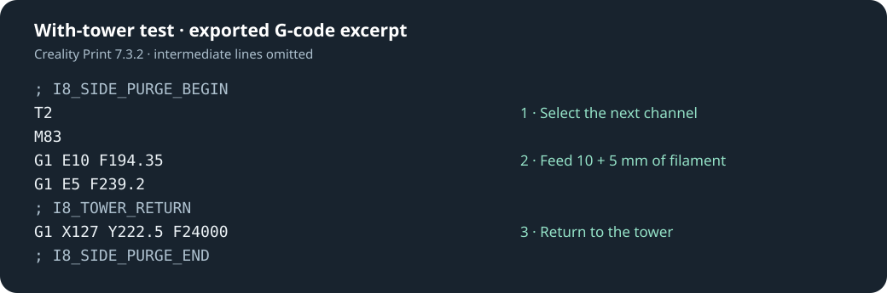

## 3. Adjust the side flush or restore the defaults

1. In **Prepare**, click the pencil beside the copied printer preset and open **Machine G-code → Change filament G-code**.
2. To adjust the total, find `EDIT SIDE_PURGE_MM` in the active block. In `G1 E{15 - 10}`, change `15` to the total filament length in millimeters. Keep it above `10` because the first step already feeds 10 mm. The with-tower filament uses a separate **12 mm³** minimum flush on the tower. The tower value is a volume.

   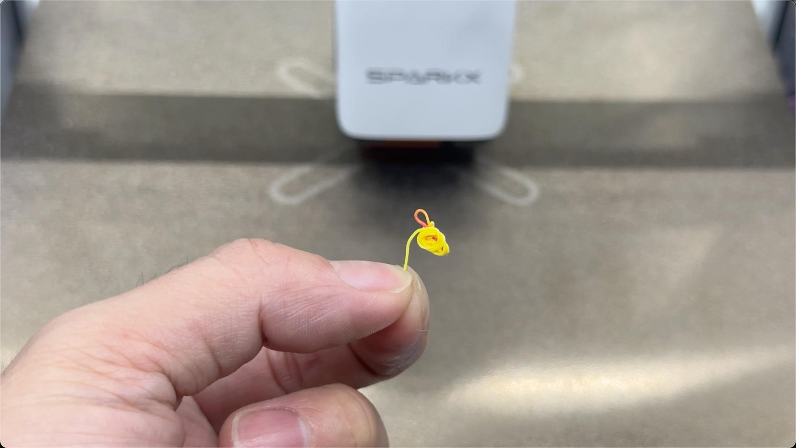

3. **Save as** a new user preset, reslice, and repeat the checks. To restore factory behavior, select the original printer, process, and filament presets and slice again.

   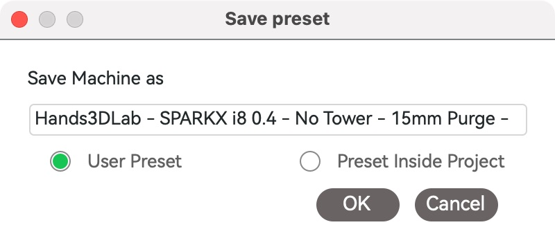

## 4. Why it works this way

**The trade-off with fast filament changes.** The i8's four-channel design shortens the switch, but the hotend still needs to extrude enough material to clear the previous color and restore steady flow. If the outer wall starts before that transition is complete, the old color can show on the surface and the first lines may be thin or broken. Side flushing moves that transition off the model and costs some extra travel time, flush time, and filament. [Creality i8 FAQ](https://wiki.creality.com/en/sparkx/i8/FAQ) · [Creality No Prime Tower Mode Guide](https://wiki.creality.com/en/sparkx/i8/no-prime-tower-mode)

**Lift Z → switch channels at the side wiper → flush in two stages → cool and wipe → return to the tower or model.**

- **Move to the side before switching.** The preset runs the `T` command and the first extrusion at the side so the waste area catches that mixed material. Lifting Z gives the nozzle clearance to leave the model. The approach to the wiper is slower than the travel across the bed.
- **Feed 10 + 5 mm, starting at a lower flow rate.** The first stage starts extrusion at a lower rate to give flow time to settle after the switch. The second uses a higher rate to clear more residue in less time. The 15 mm total is a trial setting that balances flush length and change time. Results vary with color contrast, filament, and temperature. A dark-to-light change makes residual color easier to spot. The brief cooling step is intended to help the wiper remove the flushed filament so the nozzle is less likely to drag it back to the model.
- **Give the side wiper and the prime tower distinct jobs.** The side flush clears the first mixed extrusion. The with-tower setup then prints on the tower to give the flow time to stabilize. The included PLA profile sets the slicer's extra pre-flush to `0` to reduce repeated flushing after the side sequence. The **12 mm³** minimum flush on the tower still applies. That value measures volume. The **15 mm** side setting measures filament length. [Creality Print 7.3.2 release notes](https://github.com/CrealityOfficial/CrealityPrint/releases/tag/v7.3.2)
- **Check each sliced model in no-tower mode.** Creality Print uses layer geometry to decide whether internal paths such as infill can serve as part of the color transition. Thin walls, small cross-sections, and frequent changes can limit those paths. This template adds a side flush when the slicer invokes it for an actual channel change and timed flushing has not taken over the change. Check the exported blocks when switching models. [Creality No Prime Tower Mode Guide](https://wiki.creality.com/en/sparkx/i8/no-prime-tower-mode)

Follow the [first-print and stop guidance](safety.en.md) before testing on hardware.
