# 图文操作指南

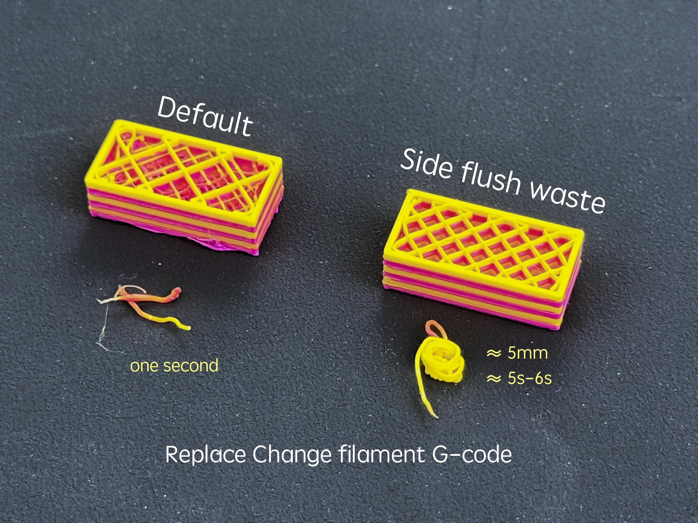

[English](guide.en.md) · [注意事项与免责](safety.zh-CN.md) · [返回 README](../README.zh-CN.md)

> [!WARNING]
> **时间代价。** 每次触发侧边冲刷的换色粗估多花 **6 秒**，其中本次擦料改进比旧版约多 **1 秒**，实际时间随配置变化。换色次数多时，额外时间会累积。如果对打印时长敏感，请勿导入这套预设或启用侧刷模板。

**v0.1 擦料更新。** 两种安装方式均已包含回抽卸压、PLA 风冷 1.8 秒、三次擦拭及 100 mm/s 末次离开。带塔版回塔后补回等量回抽，无塔版由切片器恢复出料。随附回抽长度为 0.8 mm，设为 0 时不卸压。首印同时检查挂料和返回后第一条线是否缺料。

## 1. 安装

适用配置为 **SPARKX i8、0.4 mm 喷嘴、PLA**。随附试片已用 Creality Print 7.3.2 切片检查。[Creality Print 7.3.2](https://github.com/CrealityOfficial/CrealityPrint/releases/tag/v7.3.2)

### 方式 A：手动替换（推荐）

从当前官方机型预设另存副本，只替换「换料 G-code」字段，保留当前版本的运动、温控等机器设置。升级后可从新版官方预设重新建副本，再核对模板和切片结果。

1. 在 **Prepare** 选择官方 **SPARKX i8 0.4 mm**，点击机型旁的铅笔，进入 **Machine G-code → Change filament G-code**。先备份原字段内容。
2. 按 **Prime tower** 开关选模板：[带擦料塔 G-code](../gcode/sparkx-i8-with-tower-change-filament.txt) · [无擦料塔 G-code](../gcode/sparkx-i8-no-tower-change-filament.txt)。复制文件全文，替换字段，并用 **Save as** 保存为新的用户机型预设。

   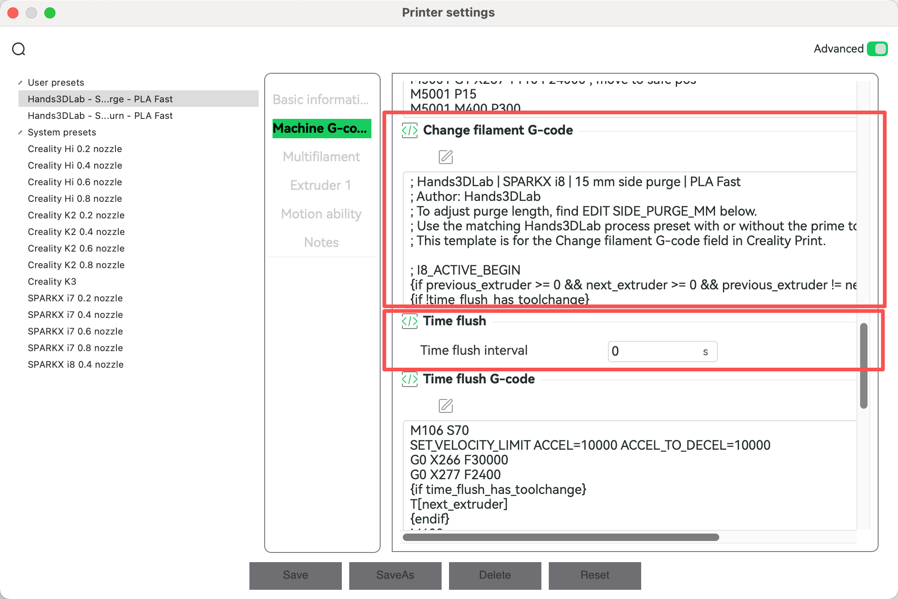

   **换料 G-code 设置。** 上方红框是粘贴位置。下方显示随附预设的 **Time flush interval 为 0 秒**。若定时冲刷接管换料，此模板会跳过侧刷。

**推荐设置。** 要复现随附试片的侧刷行为，在机型副本里将 **Time flush interval** 设为 **0 秒**，并让 **Prime tower** 开关与所选模板一致。带塔试片的随附耗材预设使用 **额外预冲刷 0 mm³**、**塔上最小冲刷 12 mm³**。手动替换时可先保留自己的耗材配置，再按切片结果决定是否调整塔上的冲刷量。

### 方式 B：一键导入

快速试用时，把[带塔](../presets/with-tower/)或[无塔](../presets/no-tower/)文件夹内的 `.3mf` 作为项目打开，即可载入随附预设。用于自己的模型时，通过 **File → Import → Import Configs** 一次选中同组的机型和工艺 JSON，带塔组同时选中耗材 JSON。回到 **Prepare** 选用导入的预设，核对擦料塔开关和料槽。

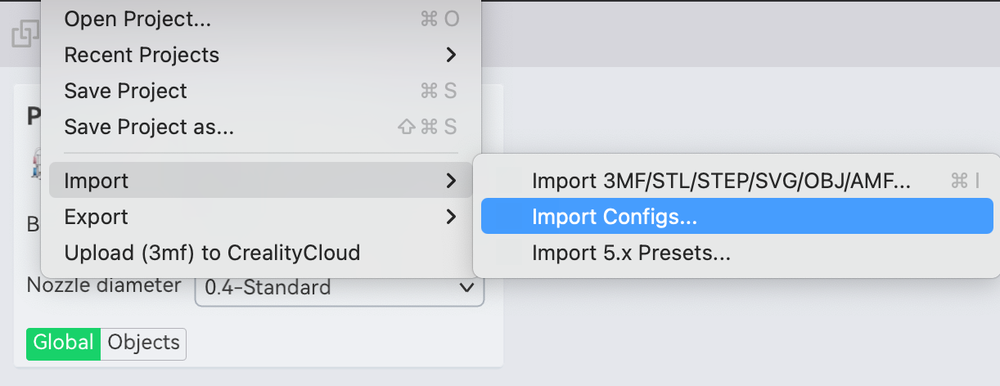

**导入预设入口。** 在 **File → Import** 菜单中选择 **Import Configs…**。

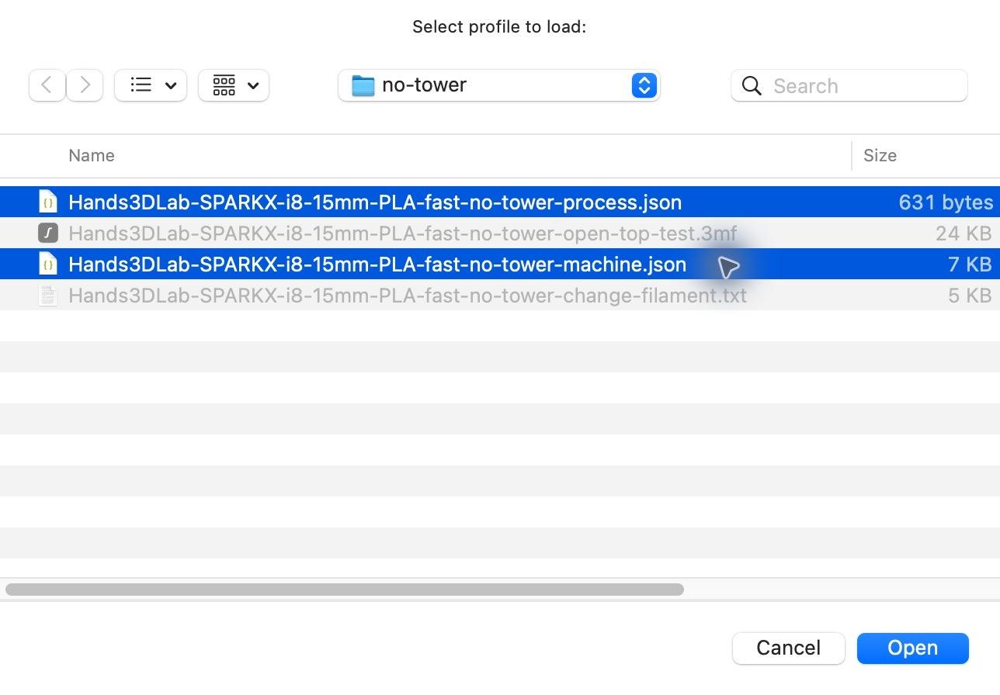

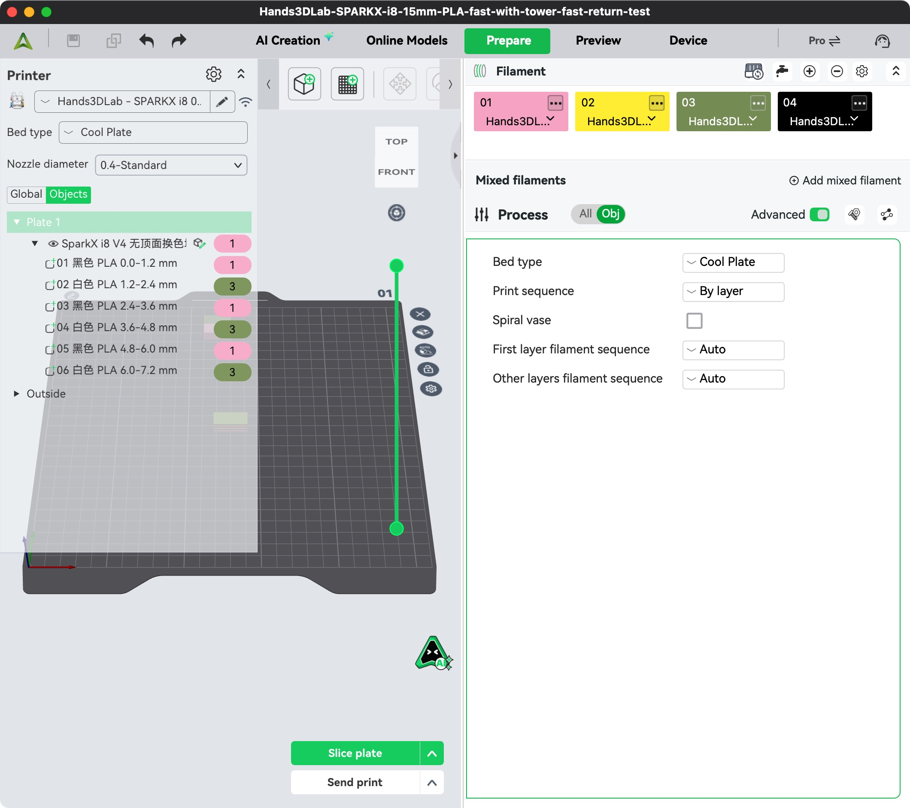

| 界面控件 | 操作 |
| --- | --- |
| **Printer（打印机）** | 选择后缀为 `PLA Fast` 的 Hands3DLab SPARKX i8 机型，核对 `With Tower` 或 `No Tower` 和 0.4 mm 喷嘴。 |
| **Filament（耗材）** | 核对颜色与料槽映射。带塔时，每个参与换色的槽位选择 `Hands3DLab - SPARKX i8 Generic PLA - Side Purge`，以应用减少塔上冲刷的设置。无塔可用随附项目的 Generic PLA。 |
| **Process（工艺）** | 选择同组、后缀为 `PLA Fast` 的工艺，确认 **Prime tower** 开关符合带塔或无塔方案。 |
| **Slice plate（切片单盘）** | 核对三项预设后执行切片。 |

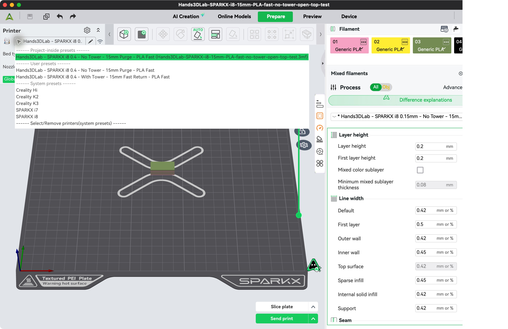

## 2. 核对切片结果

1. 打开 **Preview**，用滑块查看换色层。带塔应看到擦料塔，无塔应只有试片。自定义侧刷动作可能位于常规打印区域外，预览不一定完整显示。

   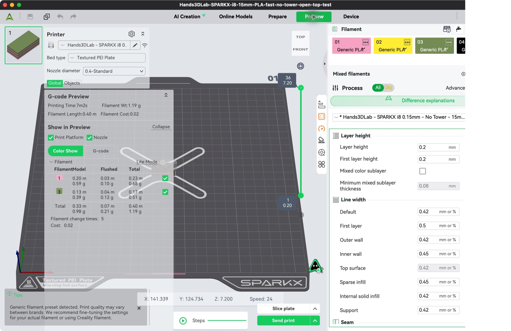

   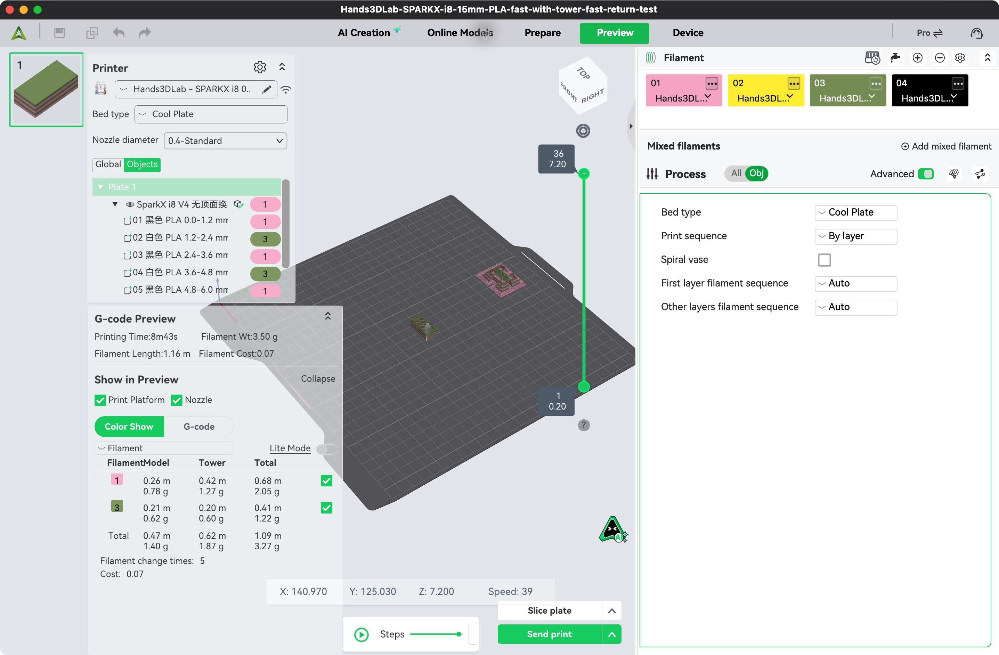
2. 通过 **Export G-code** 导出，在文本编辑器中找单独一行的 `I8_SIDE_PURGE_BEGIN`，避免把文件设置里的模板副本计入。随附试片应有 **五个**代码块。每段的 `T` 换料后，在 `M83` 相对挤出模式下有 `G1 E10` 和 `G1 E5` 两段送丝。实际进给速度随耗材预设变化。带塔版还应在 `I8_TOWER_RETURN` 后看到带 `F24000` 的 XY 移动。

   
3. 少了侧刷块时，先检查当前机型和工艺。无塔路径取决于 Creality Print 如何安排换色。换模型或固件后，根据实际导出的 G-code 重新核对再上机。

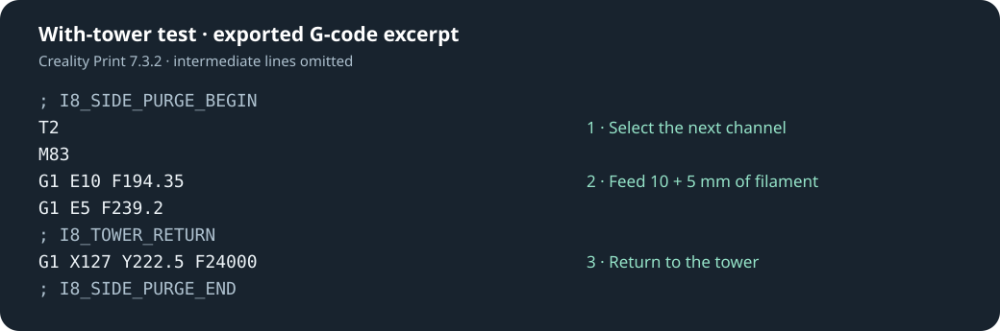

## 3. 调整侧边冲刷或恢复原配置

1. 在 **Prepare** 点击副本机型旁的铅笔，进入 **Machine G-code → Change filament G-code**。
2. 搜索活动代码中的 `EDIT SIDE_PURGE_MM`，把 `G1 E{15 - 10}` 里的 `15` 改为所需的总送丝长度，单位是毫米。第一段固定送 10 mm，因此总量要大于 10。带塔耗材的塔上最小清理量 **12 mm³** 是独立的体积参数。

   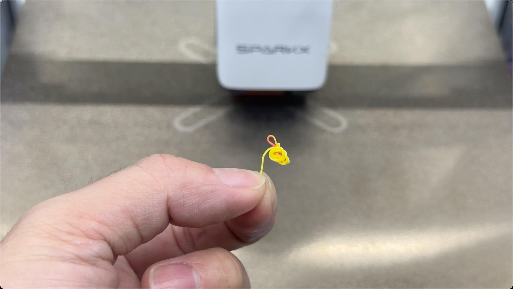

3. 用 **Save as** 另存为新预设，再切片并重复核对。要恢复出厂行为，重新选择原机型、工艺和耗材预设，再生成新文件。

   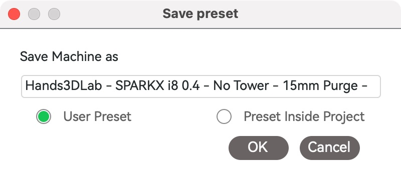

## 4. 为什么这样做

**快速换料的取舍。** i8 的四通道设计缩短了切换时间，但切换通道后仍需挤出一段耗材，让热端残留的旧色排出、流量恢复稳定。如果外墙开打时过渡还没完成，旧色会出现在表面，刚起笔的线条也可能偏细或断续。侧边冲刷把这段过渡移出模型，代价是每次换色多一段移动和冲刷，消耗少量耗材。[Creality i8 FAQ](https://wiki.creality.com/en/sparkx/i8/FAQ) · [Creality 无擦料塔模式指南](https://wiki.creality.com/en/sparkx/i8/no-prime-tower-mode)

**抬 Z → 到侧刷处切换通道 → 分两段冲刷 → 冷却并刮掉废料 → 回塔或回模型。**

- **先去侧边，再切换通道。** 预设把 `T` 换料和第一段挤出安排在侧边，让接料区承接这段混色料。抬 Z 为离开模型留出间隙，远距离空移和进入刮片分别用不同速度，避免用空移速度撞入刮片。
- **先慢后快，送丝 10 + 5 mm。** 第一段以较低流速开始出料，给换色后的挤出留出稳定时间。第二段提高流速，继续排出残料，缩短等待。15 mm 是在冲刷量和换色时间之间选的试验起点。两种颜色的反差、耗材和温度都会影响结果，尤其适合用深色换浅色来观察。冲刷后的短暂风冷是为了让废料更容易被刮掉，减少它被喷嘴带回模型的机会。
- **侧刷和擦料塔各做一部分工作。** 侧刷排出换色初段的混色料，带塔方案再走塔上的出料路径，给恢复稳定出料留出空间。随附 PLA 预设把切片器的额外预冲刷设为 `0`，以减少侧刷之后重复做的冲刷。塔上的最小清理量 `12 mm³` 仍然生效。这个值是体积，侧刷的 `15 mm` 是送丝长度。[Creality Print 7.3.2 说明](https://github.com/CrealityOfficial/CrealityPrint/releases/tag/v7.3.2)
- **无塔时看实际切片。** Creality Print 会根据每层几何决定是否利用填充等内部走线完成颜色过渡。薄壁、小截面和高频换色能用的内部走线较少。侧刷模板只在切片器调用它、确实切换通道且定时冲刷没有接管换料时加入指令，因此换模型后要核对导出的侧刷代码块。[Creality 无擦料塔模式指南](https://wiki.creality.com/en/sparkx/i8/no-prime-tower-mode)

实际打印前，请按[首印看护和停机说明](safety.zh-CN.md)检查设备。
