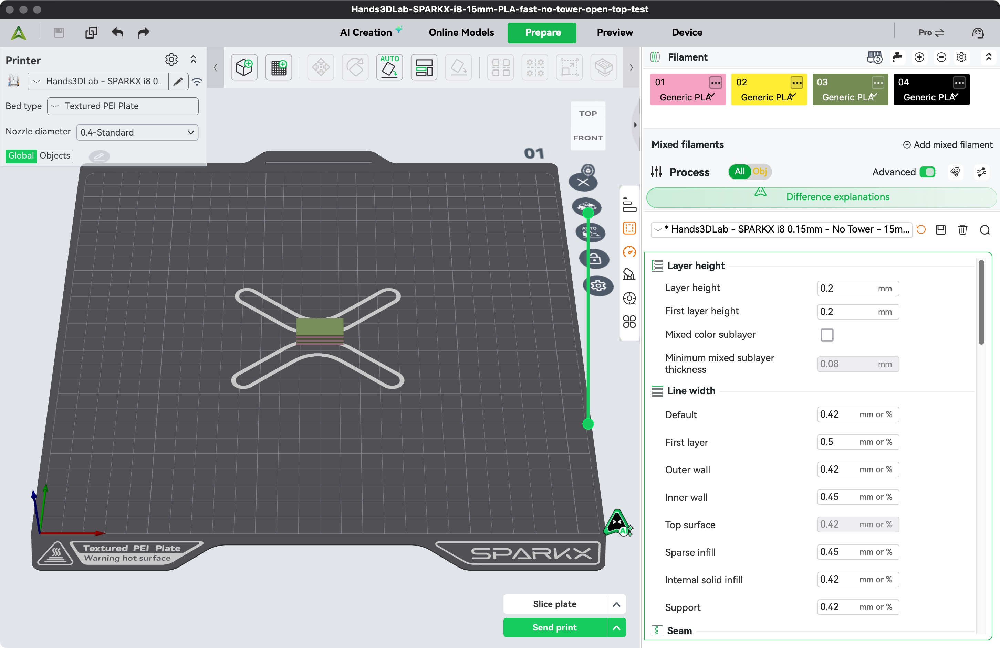
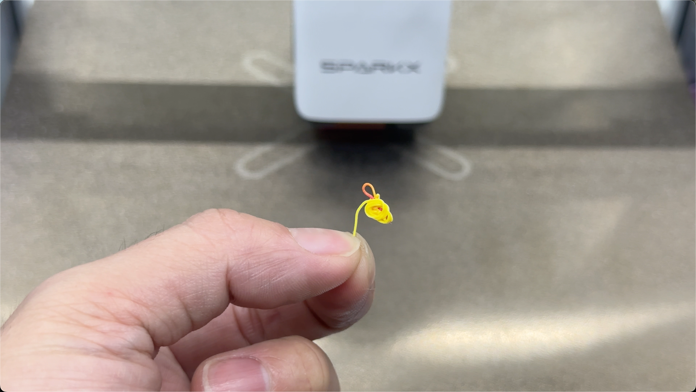

# 图文操作指南

[English](guide.en.md) · [注意事项与免责](safety.zh-CN.md) · [返回 README](../README.zh-CN.md)

图 1 是打开无塔试片后的 Creality Print 英文版 **Prepare** 页面。不同系统和版本的布局可能略有变化。

## 1. 打开试片或导入配置

最快的方法是把[带塔](../presets/with-tower/)或[无塔](../presets/no-tower/)文件夹里的 `.3mf` **作为项目打开**。试片有六段色带，顶部开放，便于观察内部填充。切片前核对载入的预设。

使用自己的模型时，先打开模型，再选 **File → Import → Import Configs**。导入同一组的 `*-machine.json` 和 `*-process.json`，带塔组还要导入 `*-filament.json`。导入后还需要到 **Prepare** 选择对应预设，尤其是打开了带旧预设的 3MF 时。

| 界面控件 | 操作 |
| --- | --- |
| **Printer（打印机）** | 选择后缀为 `PLA Fast` 的 Hands3DLab SPARKX i8 机型，核对 `With Tower` 或 `No Tower` 和 0.4 mm 喷嘴。 |
| **Filament（耗材）** | 核对颜色与料槽映射。带塔时，每个参与换色的槽位选择 `Hands3DLab - SPARKX i8 Generic PLA - Side Purge`，以应用减少塔上冲刷的设置。无塔可用随附项目的 Generic PLA。 |
| **Process（工艺）** | 选择同组、后缀为 `PLA Fast` 的工艺，确认 **Prime tower** 开关符合带塔或无塔方案。 |
| **Slice plate（切片单盘）** | 核对三项预设后执行切片。 |

## 2. 核对切片结果

1. 打开 **Preview**，用滑块查看换色层。带塔应看到擦料塔，无塔应只有试片。自定义侧刷动作可能位于常规打印区域外，预览不一定完整显示。

   

   
2. 通过 **Export G-code** 导出，在文本编辑器中找单独一行的 `I8_SIDE_PURGE_BEGIN`，避免把文件设置里的模板副本计入。随附试片应有 **五个**代码块。每段的 `T` 换料后，在 `M83` 相对挤出模式下有 `G1 E10` 和 `G1 E5` 两段送丝。实际进给速度随耗材预设变化。带塔版还应在 `I8_TOWER_RETURN` 后看到带 `F24000` 的 XY 移动。

   
3. 少了侧刷块时，先检查当前机型和工艺。无塔路径取决于 Creality Print 如何安排换色。换模型或固件后，根据实际导出的 G-code 重新核对再上机。

## 3. 调整侧边冲刷或恢复原配置

1. 在 **Prepare** 点击机型旁的铅笔，进入 **Machine gcode → Change filament G-code**。对应的 `*-change-filament.txt` 可以整段粘贴到这个字段，末尾的 `STOCK` 注释区用于对照。

   
2. 搜索活动代码中的 `EDIT SIDE_PURGE_MM`，把 `G1 E{15 - 10}` 里的 `15` 改为所需的总送丝长度，单位是毫米。第一段固定送 10 mm，因此总量要大于 10。带塔耗材的塔上最小清理量 **12 mm³** 是独立的体积参数。

   

3. 用 **Save as** 另存为新预设，再切片并重复核对。要恢复出厂行为，重新选择原机型、工艺和耗材预设，再生成新文件。

   

## 4. 为什么这样做

**快速换料的取舍。** i8 的四通道设计缩短了切换时间，但切换通道后仍需挤出一段耗材，让热端残留的旧色排出、流量恢复稳定。如果外墙开打时过渡还没完成，旧色会出现在表面，刚起笔的线条也可能偏细或断续。侧边冲刷把这段过渡移出模型，代价是每次换色多一段移动和冲刷，消耗少量耗材。[Creality i8 FAQ](https://wiki.creality.com/en/sparkx/i8/FAQ) · [Creality 无擦料塔模式指南](https://wiki.creality.com/en/sparkx/i8/no-prime-tower-mode)

**抬 Z → 到侧刷处切换通道 → 分两段冲刷 → 冷却并刮掉废料 → 回塔或回模型。**

- **先去侧边，再切换通道。** 预设把 `T` 换料和第一段挤出安排在侧边，让接料区承接这段混色料。抬 Z 为离开模型留出间隙，远距离空移和进入刮片分别用不同速度，避免用空移速度撞入刮片。
- **先慢后快，送丝 10 + 5 mm。** 第一段以较低流速开始出料，给换色后的挤出留出稳定时间。第二段提高流速，继续排出残料，缩短等待。15 mm 是在冲刷量和换色时间之间选的试验起点。两种颜色的反差、耗材和温度都会影响结果，尤其适合用深色换浅色来观察。冲刷后的短暂风冷是为了让废料更容易被刮掉，减少它被喷嘴带回模型的机会。
- **侧刷和擦料塔各做一部分工作。** 侧刷排出换色初段的混色料，带塔方案再走塔上的出料路径，给恢复稳定出料留出空间。随附 PLA 预设把切片器的额外预冲刷设为 `0`，以减少侧刷之后重复做的冲刷。塔上的最小清理量 `12 mm³` 仍然生效。这个值是体积，侧刷的 `15 mm` 是送丝长度。[Creality Print 7.3.2 说明](https://github.com/CrealityOfficial/CrealityPrint/releases/tag/v7.3.2)
- **无塔时看实际切片。** Creality Print 会根据每层几何决定是否利用填充等内部走线完成颜色过渡。薄壁、小截面和高频换色能用的内部走线较少。侧刷模板只在切片器调用它、确实切换通道且定时冲刷没有接管换料时加入指令，因此换模型后要核对导出的侧刷代码块。[Creality 无擦料塔模式指南](https://wiki.creality.com/en/sparkx/i8/no-prime-tower-mode)

实际打印前，请按[首印看护和停机说明](safety.zh-CN.md)检查设备。
